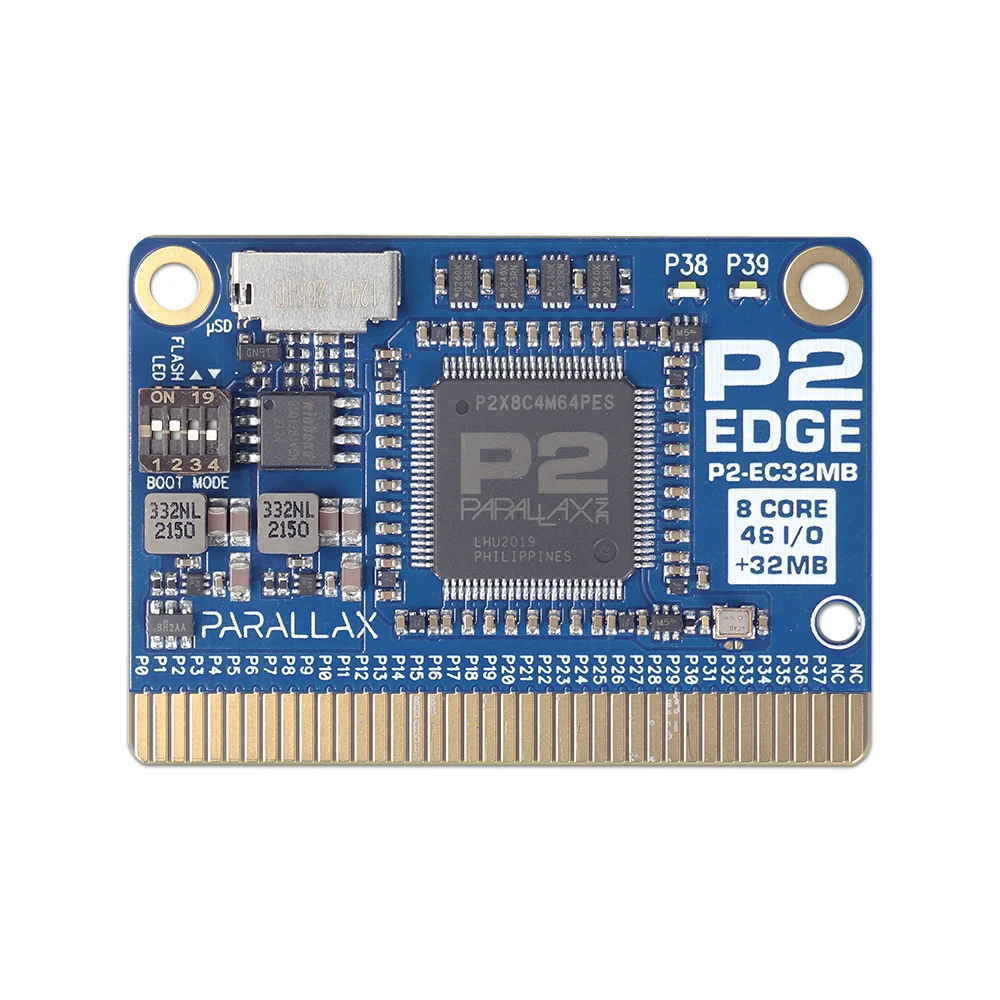
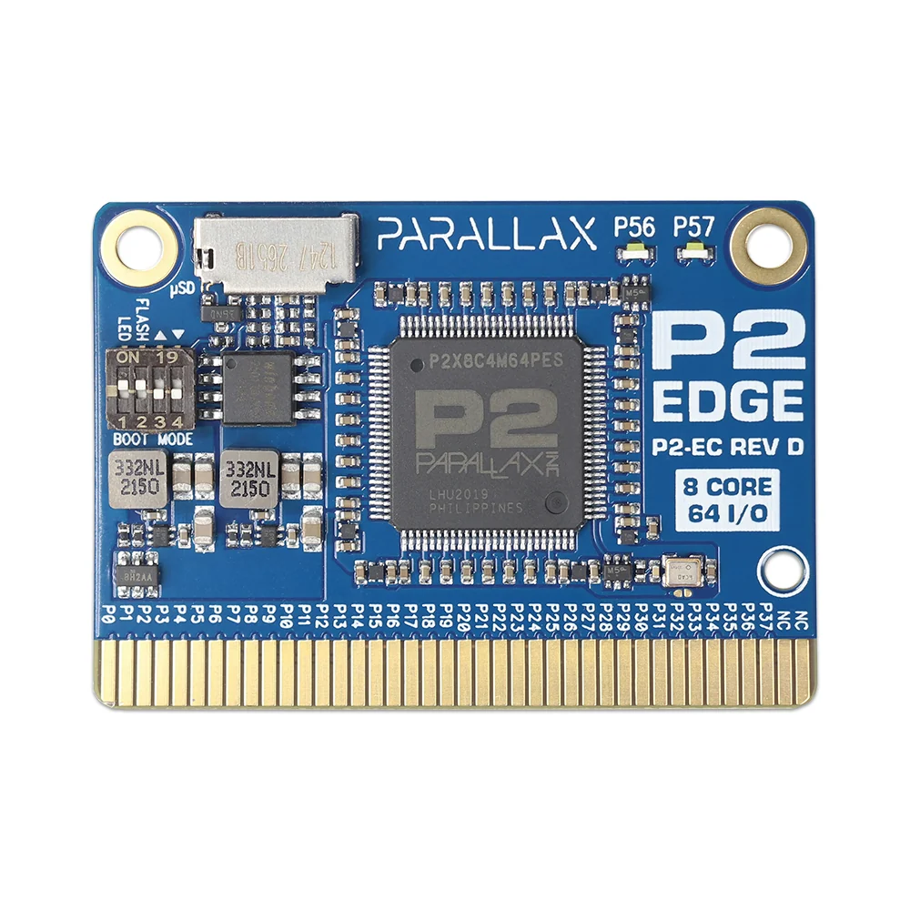

# MicroPython for the Propeller 2 Edge

The first thing I’d try on this board is an eight-megabyte array. That’s a slightly unreasonable thing to ask of a chip with 512 KiB of hub RAM, which makes it a good way to meet the P2 Edge. The interpreter lives in the hub. The array lives on the four PSRAM chips, and Python brings a page across when you ask for an element.

You can also put a cog to work while Python is busy, capture a pulse with a Smart Pin, or use part of PSRAM as a scratch disk. The first three experiments below need just the board, power and a USB serial connection.

**[Open the Propeller 2 workbench](https://speccy88.github.io/micropython-p2/)** · [Download the command-line starter ZIP](https://github.com/speccy88/micropython-p2/releases/latest/download/micropython-p2-starter.zip) · [Release notes and checksums](https://github.com/speccy88/micropython-p2/releases/latest) · [Hardware test results](ports/p2/PROGRESS.md)

## Get a prompt

 


Use a P2-EC32MB Edge, a powered carrier, and a Prop Plug or equivalent 3.3 V USB serial connection with reset. Set the board for serial-capable boot. The names on the switches vary by revision. For the first run, a RAM download lets you try Python and return to the board’s previous boot program with a power cycle. [Parallax board guide](https://www.parallax.com/package/p2-edge-module-with-32mb-ram-product-guide/)

### From your browser

1. Plug in the board and open the workbench in desktop Chrome or Edge on Windows, Linux or macOS. Close any serial terminal that already has the adapter open. [Launch the workbench](https://speccy88.github.io/micropython-p2/)
2. On the 32 MiB Edge, keep **Edge · 32 MiB PSRAM** and **Try in RAM** selected. Click **Load RAM & open ViperIDE**, then pick your USB serial adapter. The workbench checks the download, resets the P2, and opens the editor as soon as Python answers.
3. Firmware uploads use **2 Mbaud**. ViperIDE switches to **115,200 baud** for the Python console. In **blink_p2.py**, leave `EDGE_32MB = True` for the 32 MB Edge (LEDs on P38 and P39). Set it to `False` for the Edge without external RAM (P56 and P57). Press **F5** or click **Run File**. With the board's LED enable switch on, the two LEDs take turns five times. Try changing `sleep_ms(250)` to speed them up. Use **LED blinker** in the toolbar to reopen the example. It runs on Edge and Lean firmware; the Threaded profile lacks `machine.Pin`.

For a permanent install on a flash-equipped Edge, select **Boot flash** and click **Replace boot flash & open ViperIDE**. This overwrites the existing boot program. Keep the board powered until Python starts. To check it, set the board for SPI flash boot, power-cycle, then choose **Connect to the IDE**. You can also use that button whenever MicroPython is already running. The flash programming stream has automated host tests. Hardware cold boot is still unverified.

### From a terminal

Extract the **starter ZIP** and open a terminal in the folder containing this README and `ports`. These commands also work from a checkout of the repository. Install Python 3.10 or newer on the host. Python 3.12 was used for the Windows tests.

If you downloaded the first kit, get the current ZIP. Kit.1 damaged four binaries during packaging, including the Linux bytecode compiler. On Windows, Linux or macOS, run `python ports/p2/tools/make_starter.py --check-files` in the extracted kit to check the firmware and compiler before flashing. On Windows you can also use `py -3` in place of `python`. [Original file hashes and ZIP verification](ports/p2/validation/STARTER.md)

**Windows PowerShell**

```powershell
py -3 -m venv .venv
$env:Path = "$PWD\.venv\Scripts;$env:Path"
python -m pip install pyserial==3.5 mpremote==1.29.0
python -m serial.tools.list_ports -v
$port = "COM12"
python ports/p2/tools/ram_session.py ports/p2/firmware/edge.bin --port $port
```

**Linux**

```sh
python3 -m venv .venv
. .venv/bin/activate
python -m pip install pyserial==3.5 mpremote==1.29.0
python -m serial.tools.list_ports -v
port=/dev/ttyUSB0
python ports/p2/tools/ram_session.py ports/p2/firmware/edge.bin --port "$port"
```

**macOS, including Apple Silicon**

```sh
python3 -m venv .venv
. .venv/bin/activate
python -m pip install pyserial==3.5 mpremote==1.29.0
python -m serial.tools.list_ports -v
port=/dev/cu.usbserial-EXAMPLE
python ports/p2/tools/ram_session.py ports/p2/firmware/edge.bin --port "$port"
```

Replace the example port with the device that appears when you plug in the adapter. On macOS use its `/dev/cu.*` name. A successful load reports the P2 ROM version, a checksum acknowledgement, and the MicroPython banner. **Leave this terminal open.** It holds the physical serial port so opening and closing a tool won’t reset a RAM-loaded board. Its socket listens only on your computer.

Open a **second terminal** in the same folder. In PowerShell run `$env:Path = "$PWD\.venv\Scripts;$env:Path"`. On Linux or macOS run `. .venv/bin/activate`. Then run:

```sh
mpremote connect socket://127.0.0.1:8122 repl
```

At the `>>>` prompt, try:

```python
import gc, machine, p2
print(machine.freq())          # 160000000
print(p2.PSRAM().capacity())  # 33554432
print(gc.mem_free())          # free bytes for ordinary Python objects
```

Ctrl-C interrupts a running Python program. Ctrl-D restarts the interpreter. Ctrl-] leaves the host’s interactive console so you can run another `mpremote` command.

## Experiment 1 ◆ Put a sample two million places away

Paste this in the REPL. Give the final line a blank line to finish the block.

```python
from p2array import Array

with Array("I", 2 * 1024 * 1024, pages=2, page_bytes=256) as samples:
    samples[0] = 123
    samples[2_000_000] = 456
    print(samples[0], samples[2_000_000])

```

That’s 2,097,152 unsigned 32-bit entries with two 256-byte cache pages. You should see `123 456`. Leaving the block flushes the cache and releases the external allocation. For a logger, transferring a window of adjacent samples with `writefrom` or `readinto` is faster than assigning each element from Python. To reproduce the full write, readback and random-access check, leave the REPL and run:

```sh
mpremote connect socket://127.0.0.1:8122 run ports/p2/examples/external_array.py
```

Lists, dictionaries and the live VM still use hub RAM. For a large *program*, `p2overlay.Program` loads cooperating bytecode modules one at a time from a mounted volume. The board ran 237,971 bytes of compiled modules this way with 69,088 bytes of free heap at the start. [Overlay example and measurements](ports/p2/PROGRESS.md#using-external-memory)

## Experiment 2 ◆ Give a cog its own job

Try this in the REPL. `Cog(100)` starts a native counter with a 100-microsecond interval. The counter has its own cog, so it keeps ticking while Python allocates and collects memory.

```python
import gc, p2, time
worker = p2.Cog(100)
try:
    before = worker.count()
    scratch = [bytearray(128) for i in range(20)]
    gc.collect()
    time.sleep_ms(100)
    print(worker.id(), worker.count() - before)
finally:
    worker.stop()

```

Expect a positive cog number and roughly a thousand ticks or more. For a driver of your own, the checksum example includes assembly source, a packed driver and the Python mailbox code. The loader keeps the code and mailbox alive across GC and reclaims the cog on reset. [Driver format and build recipe](ports/p2/drivers/README.md#loadable-hubexec-drivers)

## Experiment 3 ◆ Make a disposable disk

```sh
mpremote connect socket://127.0.0.1:8122 run ports/p2/examples/ramfs.py
```

You’ll see `P2 PSRAM volume`. The script allocates 512 KiB, formats that allocation as LittleFS2, writes a file, reads it back and unmounts it. For a package you want to keep across commands, create a longer-lived mount and use `mpremote resume mip install`. The host downloads the package and sends it over serial. [Copy files and install your first package](ports/p2/README.md#storage-and-packages)

For persistence, the Edge can mount a FAT-formatted microSD card as its root. Friendly startup runs `boot.py`, then `main.py`. Back up any existing scripts before replacing them. A raw-mode soft reset skips startup scripts for recovery. The port also provides a guarded SPI-flash block device for a separately provisioned filesystem. [Storage layout](ports/p2/storage/FLASH.md)

## Put Python on a microSD card

If your Edge already has something you like in boot flash, a spare FAT32 card makes a handy Python disk. With a card reader, copy `ports/p2/firmware/edge.bin` into the root of a freshly formatted MBR/FAT32 card as **`_BOOT_P2.BIX`**. Copy it first so its sectors are contiguous. You can then put your `main.py` beside it. Power off the carrier before inserting the card.

With serial boot enabled, open **Can I boot my SD card?** in the workbench and choose **Boot SD & open ViperIDE**. The ROM reads the interpreter from the card, and the same browser tab connects to it. If you only have the board's card slot, the USB installer in the storage guide can create the file and verify its raw sectors. The guide also gives the switch settings for starting automatically at power-on. [Workbench](https://speccy88.github.io/micropython-p2/) · [SD installation and recovery](ports/p2/storage/ACCEPTANCE.md#boot-the-interpreter-from-sd)

## Install Python in boot flash

**This replaces the existing boot program at SPI-flash offset zero.** Keep a recoverable copy of that program, identify the correct board and try the RAM image first. Remove the microSD card with power off for the first cold-boot check so its own boot program cannot mask the result. Restore power and enable flash boot with a serial window using your board revision’s guide. Close the RAM session and any serial terminal before programming.

In the activated environment, this first command verifies the firmware and prepares the programmer entirely on the host:

```sh
python ports/p2/tools/flash_boot.py --profile edge --check
```

Then run **one** command, using the same physical port you identified earlier:

| Host | Program boot flash |
| --- | --- |
| Windows PowerShell | `python ports/p2/tools/flash_boot.py --profile edge --port $port --write-boot-flash` |
| Linux or macOS | `python ports/p2/tools/flash_boot.py --profile edge --port "$port" --write-boot-flash` |

Keep power connected through the transfer and programming. The helper sends the upstream loadp2 flash programmer followed by the exact release image, then watches for the MicroPython banner. Once it reports startup, power-cycle the board and connect **without downloading again**:

```sh
python -m serial.tools.miniterm "$port" 115200
```

Press Enter, then run `import p2; print(p2.PSRAM().capacity())`. Seeing `33554432` after a power cycle confirms this Edge booted the installed port. Ctrl-] exits miniterm. The flash package and checksum path have host-side checks. Persistent programming and power-cycle boot are pending physical acceptance. The Windows USB RAM path was tested on COM12. Linux and macOS use the same Python loader, and their USB paths await hardware testing. [Flash programmer source](https://github.com/totalspectrum/loadp2/tree/c20afedd4253d09da449fa740f8d4304481fc560)

## Pick your next project

| I want to… | Start here |
| --- | --- |
| Measure a frequency, drive a servo, or log ADC samples | [Pin map, wiring and runnable examples](ports/p2/drivers/README.md) |
| Connect a sensor or small display | [TMP102 example](ports/p2/examples/tmp102.py), [SSD1306 example](ports/p2/examples/ssd1306.py), [UART, SoftI2C and SoftSPI](ports/p2/bus/README.md) |
| Share a peripheral between Python workers | Select `threaded.bin`. The main cog owns the native driver and pins. Both Python workers can submit requests through its mailbox under the GIL. [Threading and GC](ports/p2/VM.md) |
| Edit on the board, send MIDI, or fetch HTTP data over USB | Install optional packages on a mounted volume with stock mpremote. The examples include a serial line editor, MIDI output, counted edge callbacks and a host HTTP bridge. [Application recipes](ports/p2/packages/APPLICATIONS.md) |
| Use a plain P2 Edge without PSRAM | Select `lean.bin`. Its larger hub heap suits small programs that need no external memory. [Image sizes and hashes](ports/p2/firmware/manifest.json) |
| Compile my own firmware or bytecode | [Build from source](ports/p2/README.md#build-from-source). The kit includes Linux x86-64 `mpy-cross`. Plain `.py` files run from all three hosts. |
| See which peripherals were exercised on silicon | [Coverage, benchmarks and limits](ports/p2/PROGRESS.md). External sensors, displays and calibrated analog measurements need their respective hardware. |

The console owns P62/P63, the Edge memory uses P40–P57, and SD and flash share P58–P61. Check the wiring table before attaching a peripheral. If a pin is busy, call the original device’s `deinit()` or stop the driver before reusing it.

**If the prompt goes missing**, close other programs using the port, check power and reset wiring, and retry the RAM command with `--baud 115200`. A Linux permission error means your account needs access to the serial device, commonly through its `dialout` group. If imports vanish between host commands, use `resume` for a live PSRAM mount. A power cycle clears its contents.

This port builds on upstream MicroPython, the TinyGo/P2 compiler work and earlier Propeller ports. [Source history and acknowledgements](ports/p2/SOURCES.md) · [Upstream MicroPython README](README-upstream.md) · [License](LICENSE)
